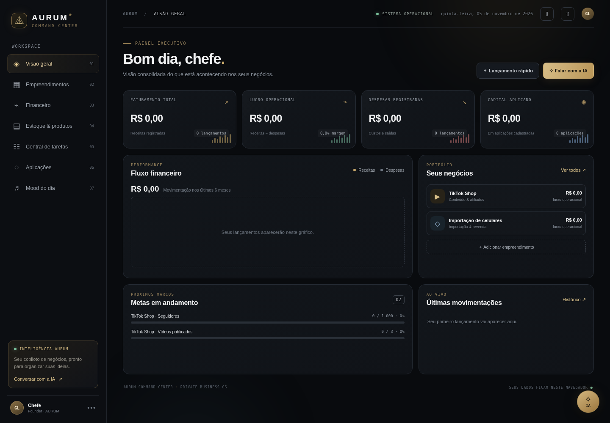
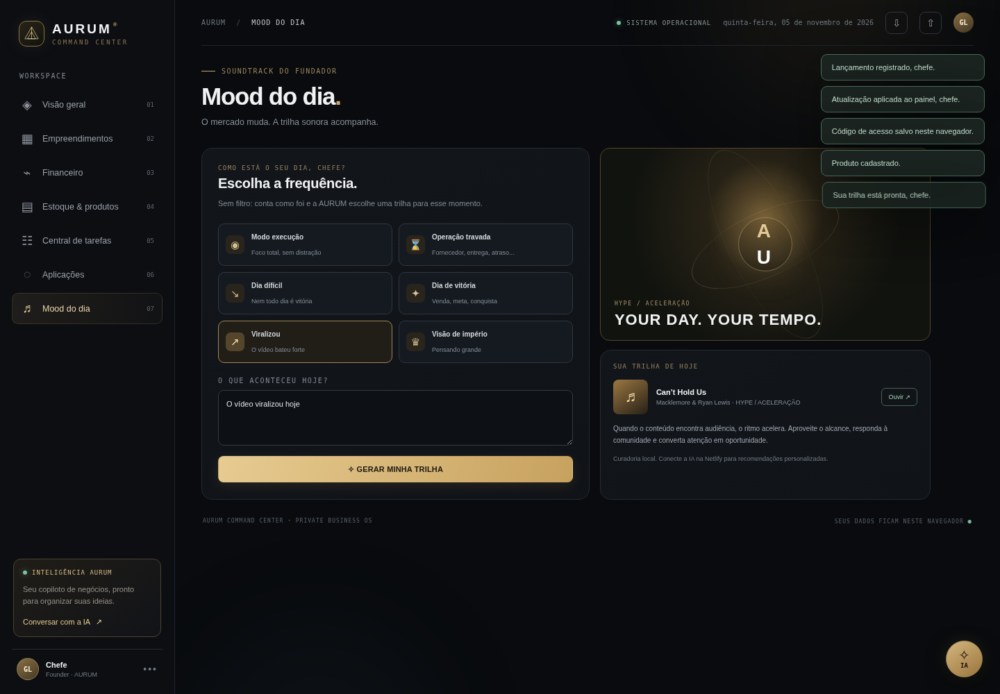

# A U R U M
### COMMAND CENTER

**THE ART OF BUSINESS INTELLIGENCE.**

*Uma visão. Múltiplos negócios. Um único centro de comando.*

 

  

---

# ◈ A VISÃO

O **AURUM Command Center** nasce de uma filosofia: grandes resultados exigem visão estratégica, organização e controle das operações.

Mais do que um dashboard, o AURUM é uma central de inteligência empresarial desenvolvida para reunir diferentes negócios, acompanhar indicadores e transformar informações em decisões.

Um ambiente único para visualizar o presente, controlar operações e construir o futuro.

> "Wealth is built through vision, discipline and execution."

---

# ◈ THE COMMAND CENTER

Uma visão consolidada de tudo o que acontece nos negócios.

COMMAND CENTER — Visão executiva das operações.

### Gestão financeira
- Acompanhamento de receitas e despesas.
- Controle de lucro e resultados.
- Indicadores financeiros.
- Metas e evolução patrimonial.

### Gestão de negócios
- Organização de múltiplas operações.
- Acompanhamento individual de cada empreendimento.
- Centralização de informações.
- Controle de desempenho.

### Inteligência operacional
- Gerenciamento de tarefas e prioridades.
- Registro de atividades.
- Acompanhamento de investimentos.
- Organização de documentos e comprovantes.

---

# ◈ BUSINESS INTELLIGENCE

O AURUM foi pensado para diferentes modelos de operação.

| Área | Controle estratégico |
|---|---|
| E-commerce | Vendas, custos e resultados |
| TikTok Shop | Seguidores, conteúdo e desempenho |
| Importações | Produtos, fretes, impostos e custos |
| Revenda | Estoque, preços e margens |
| Investimentos | Capital aplicado e evolução |
| Operações | Tarefas, metas e produtividade |

---

# ◈ ARTIFICIAL INTELLIGENCE

### Your intelligent business assistant.

AI ASSISTANT — Inteligência aplicada à gestão.

A inteligência artificial amplia a experiência de gestão, permitindo registrar informações e organizar operações por meio de conversas.

O objetivo é tornar o gerenciamento mais intuitivo, reduzir tarefas repetitivas e facilitar o acesso às informações importantes.

---

# ◈ THE EXPERIENCE

Uma interface construída para transmitir clareza, sofisticação e controle.

THE AURUM EXPERIENCE

- Dark interface.
- Black & Gold identity.
- Visualização de indicadores.
- Experiência responsiva.
- Organização por áreas de negócio.

---

# ◈ THE TECHNOLOGY

O projeto utiliza tecnologias modernas para sustentar sua estrutura:

- **Frontend:** interface web.
- **Supabase:** banco de dados e autenticação.
- **Artificial Intelligence:** integração com IA.
- **Netlify:** hospedagem e publicação.

---

# ◈ THE PHILOSOPHY

O AURUM representa três princípios:

### VISION
Enxergar oportunidades e antecipar movimentos.

### CONTROL
Conhecer os números e dominar as operações.

### EXECUTION
Transformar estratégia em resultados.

---

# AURUM

### COMMAND CENTER

*Built for those who think beyond the ordinary.*

 

**ONE VISION. MULTIPLE VENTURES. TOTAL CONTROL.**

 

  

© AURUM Command Center — All rights reserved.

